# BugTrack

BugTrack is a small app for keeping track of bugs until they are fixed. You add a bug with a title and a component, and move it through **open**, **investigating**, **resolved** and **closed**. The app itself is simple on purpose. Most of the work in this project is the DevOps side around it: tests, Docker, a CI/CD pipeline with a security scan, Terraform on AWS, Kubernetes with Helm, and monitoring.

Presentation for the demo: [BugTrack-Capstone.pptx](demo/BugTrack-Capstone.pptx)

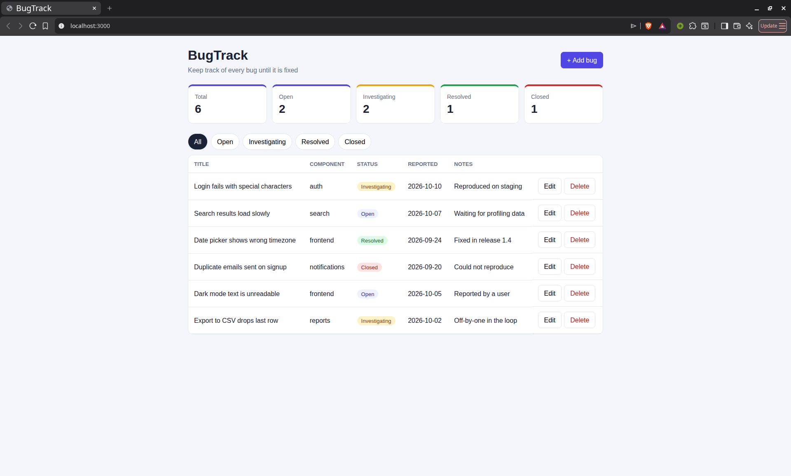

## Contents

[Architecture](#architecture) · [Quick start](#quick-start) · [M1 App](#m1-the-app) · [M2 Tests](#m2-tests) · [M3 Git](#m3-git) · [M4 Docker](#m4-docker) · [M5 CI/CD](#m5-cicd) · [M6 Trivy](#m6-trivy) · [M7 Terraform](#m7-terraform) · [M8 Kubernetes and Helm](#m8-kubernetes-and-helm) · [ArgoCD](#gitops-with-argocd) · [M9 Monitoring](#m9-monitoring) · [Troubleshooting](#troubleshooting) · [Live demo](#live-demo) · [What I learned](#what-i-learned)

## Architecture

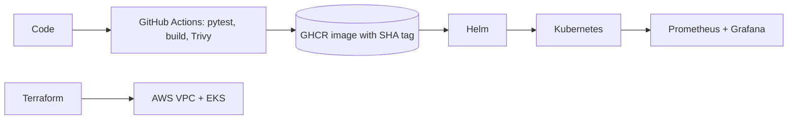

How a request travels inside the cluster:

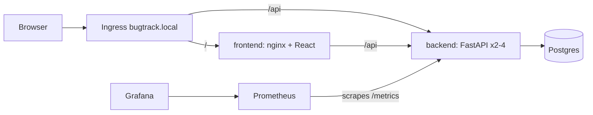

| Part | Tools |
|---|---|
| Frontend | React, Vite, nginx |
| Backend | FastAPI, SQLAlchemy, Alembic |
| Database | PostgreSQL 16 |
| CI/CD | GitHub Actions, GHCR, Trivy |
| Infrastructure | Terraform, AWS (VPC, EKS) |
| Deployment | Docker Compose, Kubernetes, Helm |
| Monitoring | Prometheus, Grafana |

```text
backend/            FastAPI app, migration, tests, Dockerfile
frontend/           React app, Dockerfile
docker-compose.yml  postgres, backend and frontend
helm/bugtrack/      Helm chart
k8s/                namespace
terraform/          VPC and EKS
monitoring/         Prometheus and Grafana setup
troubleshooting/    two broken manifests and how I fixed them
scripts/            deploy and load test scripts
.github/workflows/  CI/CD pipeline
images/             screenshots
```

## Quick start

You only need Docker. This starts Postgres, runs the migration, and serves the app:

```bash
docker compose up --build
```

| What | Where |
|---|---|
| App | http://localhost:3000 |
| API | http://localhost:8000/api/bugs |
| API docs | http://localhost:8000/docs |
| Metrics | http://localhost:8000/metrics |

## M1: The app

The backend is FastAPI with Postgres.

| Method | Path | What it does |
|---|---|---|
| `GET` | `/api/bugs` | list all bugs |
| `POST` | `/api/bugs` | add a bug |
| `GET` | `/api/bugs/{id}` | get one bug |
| `PUT` | `/api/bugs/{id}` | edit a bug |
| `DELETE` | `/api/bugs/{id}` | delete a bug |
| `GET` | `/api/bugs/stats` | counts for the cards at the top |
| `GET` | `/health` | the process is alive |
| `GET` | `/ready` | the database answers (503 if not) |
| `GET` | `/metrics` | Prometheus metrics |

A bug has a `title`, a `component`, a `status` (`open`, `investigating`, `resolved` or `closed`), a `reported_on` date and some `notes`. The `bugs` table is created by an Alembic migration (`backend/alembic/versions/`).

The frontend is React. It shows the counts at the top, a filter for each status, and a table where I can edit or delete a bug.


It also works on a small screen. The notes column is hidden below 600px so the table still fits:

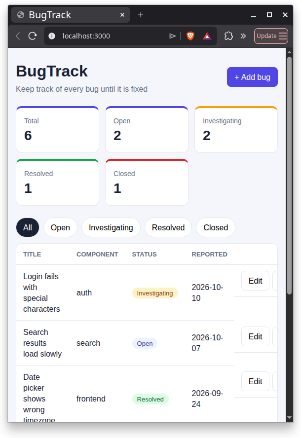

## M2: Tests

I wrote 16 pytest tests. They check every endpoint, bad input, missing ids (404), `/metrics`, and that `/ready` gives 503 when the database is down. The tests use an in-memory SQLite database, so they never touch the real Postgres. The settings are in `backend/pytest.ini`.

```bash
cd backend
python3.12 -m venv .venv && source .venv/bin/activate
pip install -r requirements-dev.txt
pytest -v
```

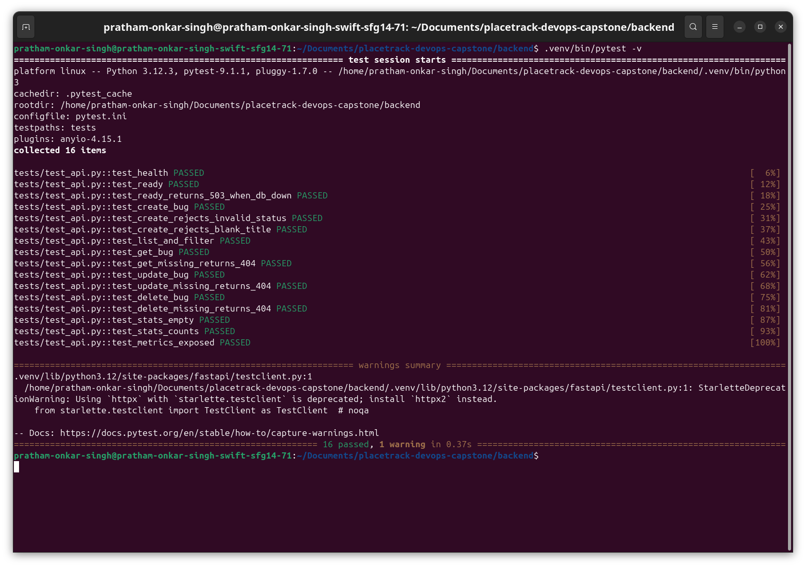

## M3: Git

I worked in small commits and wrote what each one changes in the message. `.gitignore` keeps `.env`, `__pycache__`, `node_modules`, `.venv` and the Terraform state out of the repo. The only env file in the repo is `.env.example`, and no passwords are committed.

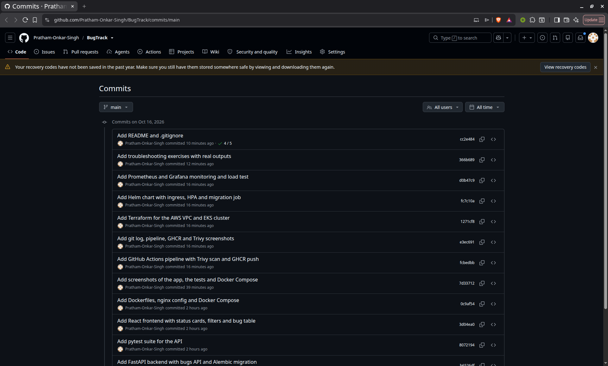

## M4: Docker

Both images run as a normal user, not root: the backend as user 10001 and the frontend as user 101. The frontend Dockerfile has two stages. Node builds the React app and only the built files go into the `nginx-unprivileged` image. With Docker Compose the whole app (postgres, backend, frontend) starts with one command:

```bash
docker compose up --build      # open http://localhost:3000
```

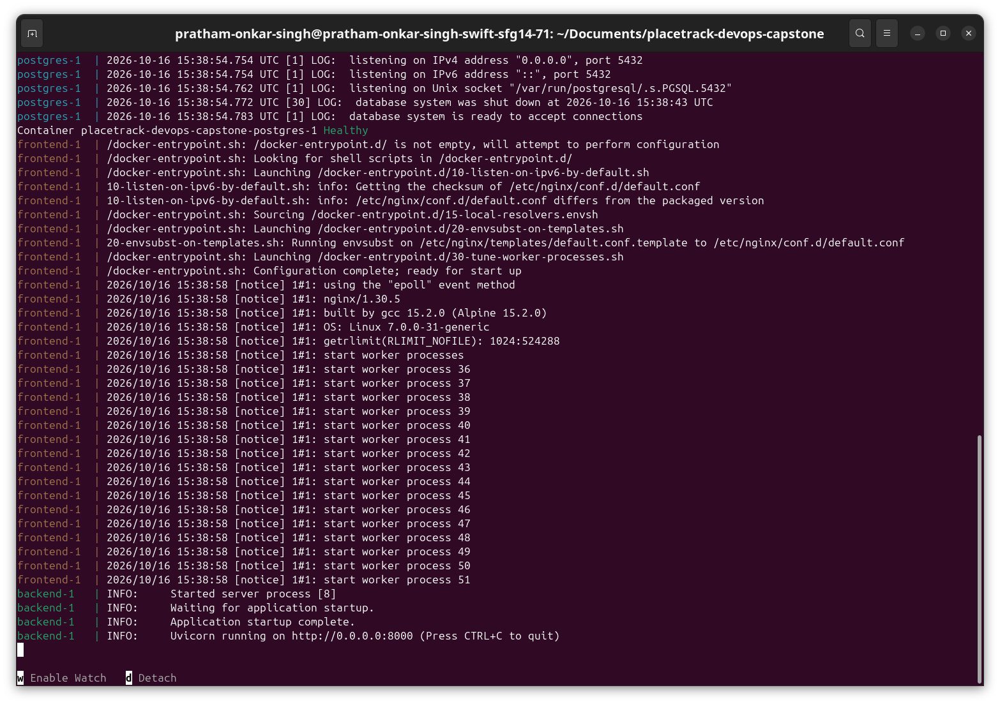

## M5: CI/CD

The workflow is `.github/workflows/ci-cd.yml` and it runs on every push to `main` and on pull requests.

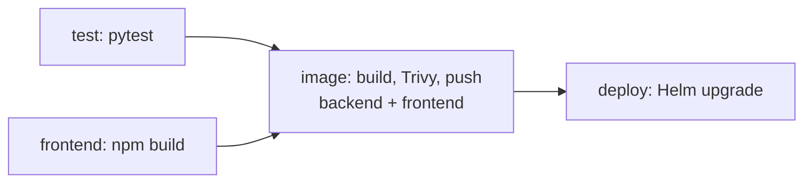

1. **test** runs pytest and **frontend** builds the React app, in parallel.
2. If both pass, **image** builds the two Docker images, scans them with Trivy, and on `main` pushes them to GHCR as `ghcr.io/<owner>/bugtrack-<service>:<commit SHA>`.
3. **deploy** runs on a self-hosted runner and does a Helm upgrade with the new SHA, so a push updates the running app by itself. I turn it on with the repository variable `DEPLOY_ENABLED`, otherwise the job is skipped.

I tag every image with the commit SHA and not `latest`, so I always know which code is running. If a test fails or Trivy finds a fixable HIGH or CRITICAL problem, the pipeline stops and nothing is pushed. All actions are pinned to a commit SHA.

Pipeline runs: [Actions tab](https://github.com/Pratham-Onkar-Singh/BugTrack/actions)

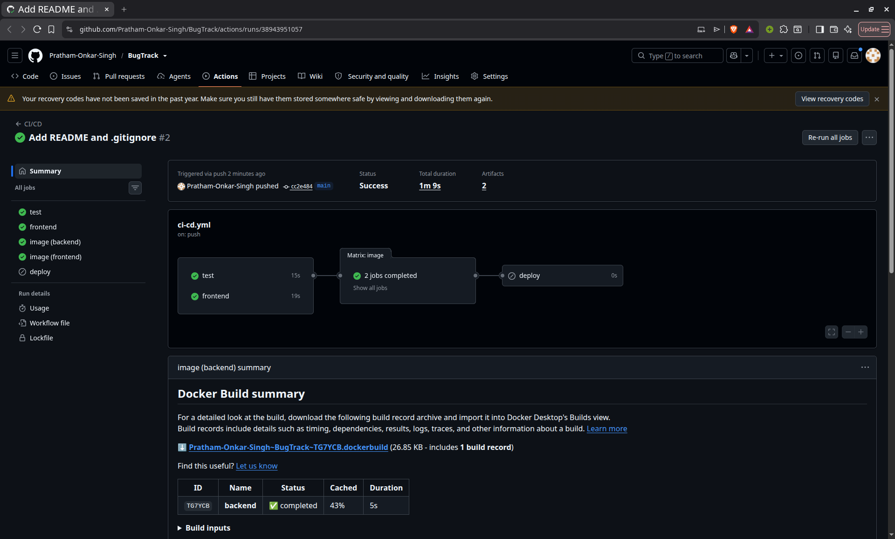

Both images are public in GHCR with the commit SHA as the tag:


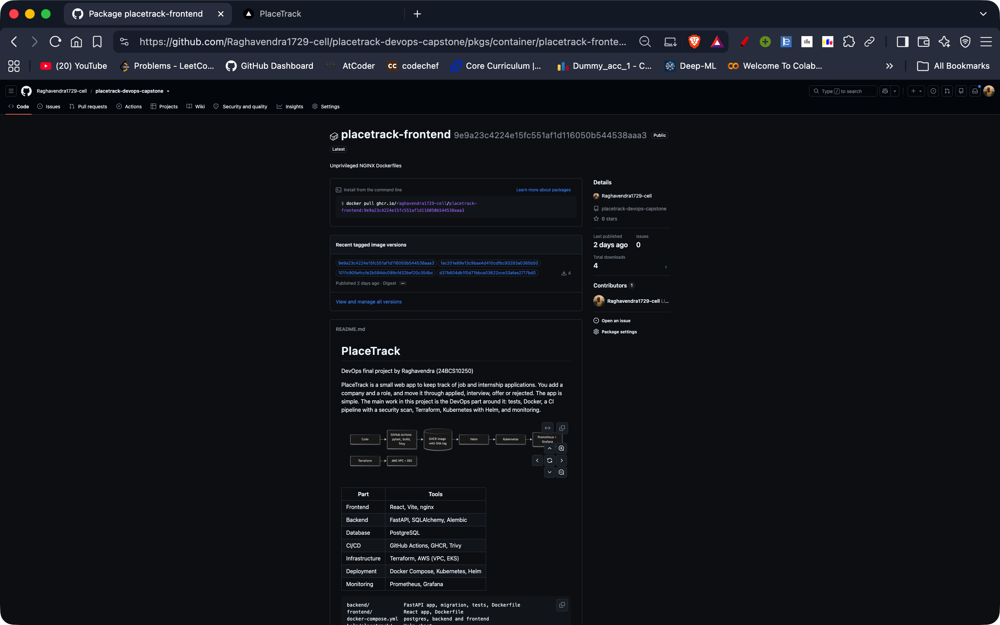

## M6: Trivy

Trivy scans both images in the pipeline and fails the job on fixable HIGH or CRITICAL findings (`severity: HIGH,CRITICAL`, `ignore-unfixed: true`, `exit-code: 1`). The scan runs before the push step, so an image with a known fixable problem never reaches GHCR.

**What the scan found.** Trivy checked the operating system packages of each image and, for the backend, the Python packages from `requirements.txt`. The backend image (Debian 13.7) and the frontend image (Alpine 3.24.2) both came back with 0 vulnerabilities, so the job passed and the images were pushed. A clean scan does not mean the image is safe forever, only that nothing fixable was known on that day. That is why it runs on every build.

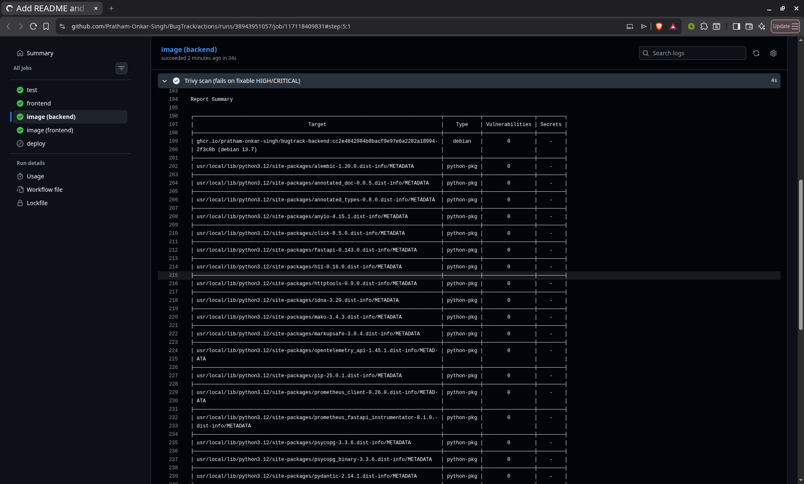

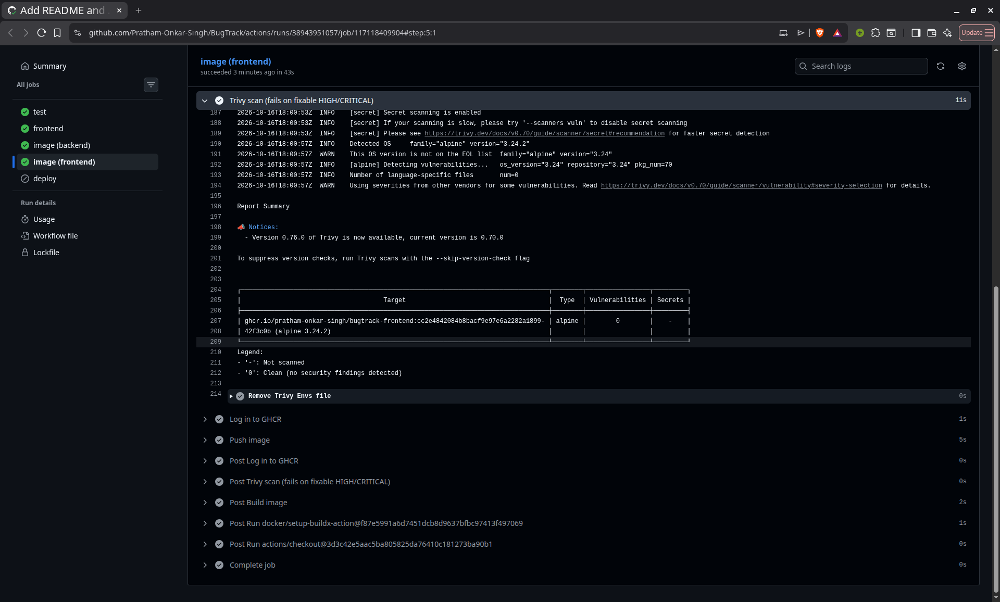

## M7: Terraform

In `terraform/` I describe the AWS setup: a VPC (`10.0.0.0/16`) with two public subnets in two availability zones, and an EKS 1.35 cluster with a node group of two `t3.small` nodes, in `ap-south-1`. Only my IP can reach the cluster API (`api_access_cidrs`). I keep that value in `terraform.tfvars`, which is not committed (see `terraform.tfvars.example`), and there are no AWS keys in the repo.

```bash
cd terraform
terraform init
terraform validate
terraform plan -out=tfplan
terraform apply tfplan
terraform destroy
```

The plan wants to create 49 resources:

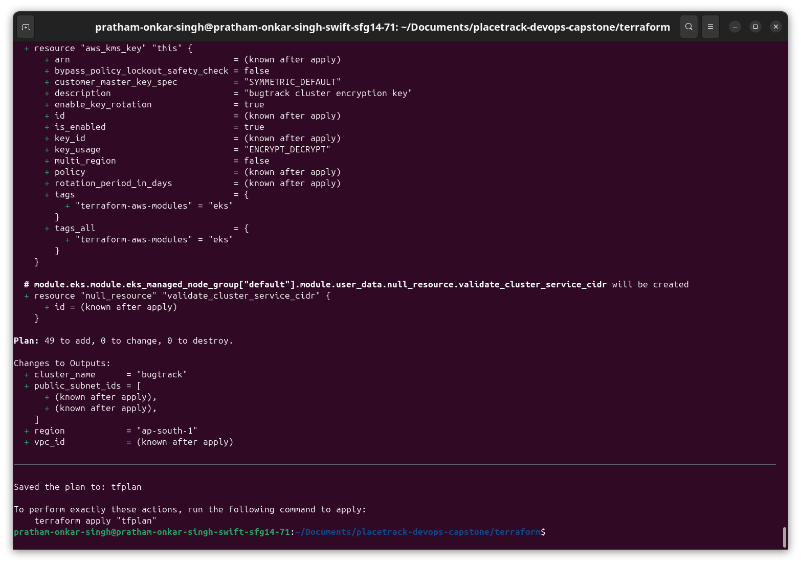

After `terraform apply` I checked everything in the AWS Console: the VPC with its two subnets, the cluster, and the two nodes in Ready state.

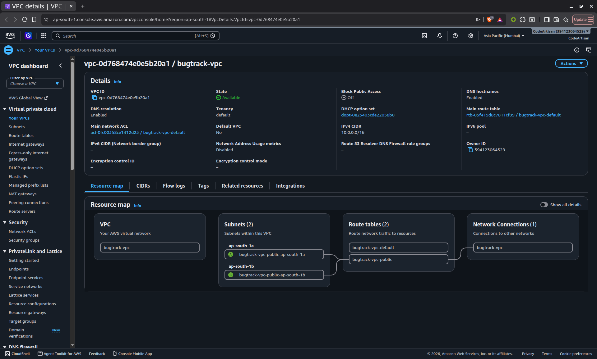

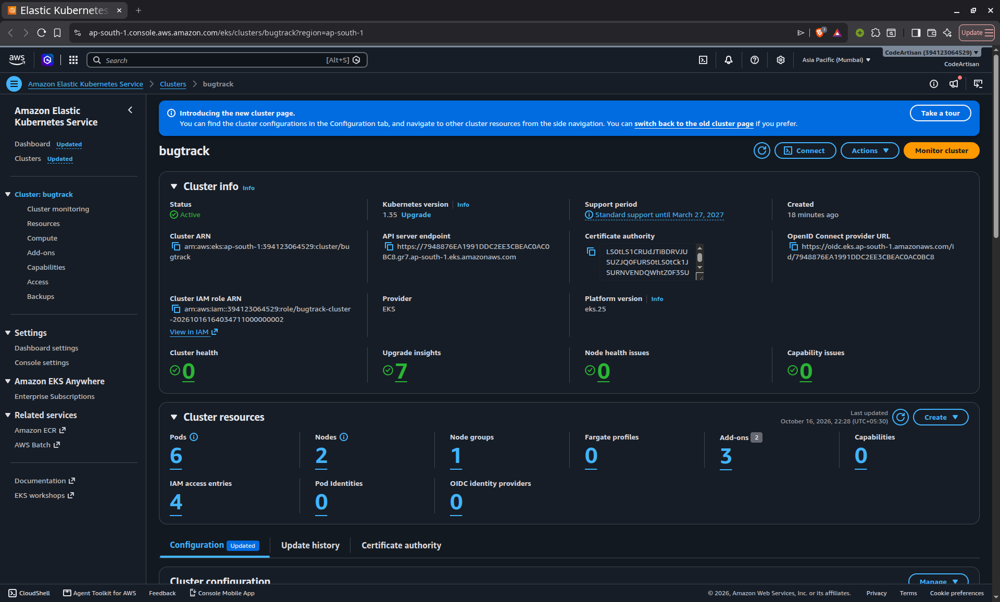

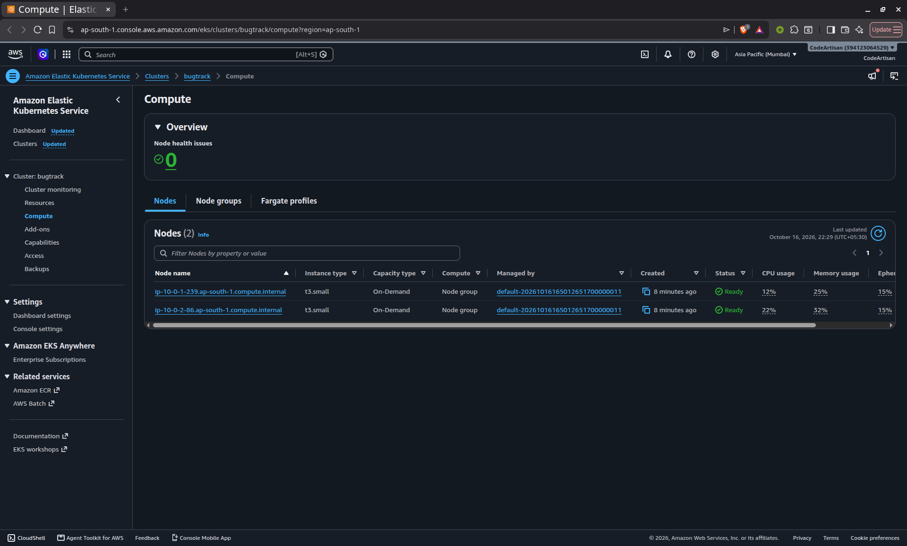

EKS costs money every hour, so after the screenshots I ran `terraform destroy`. It removed all 49 resources, and I checked that no cluster or VPC was left:

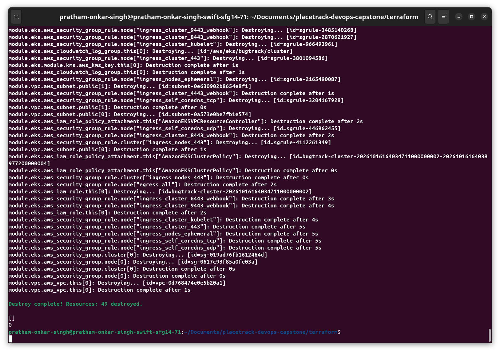

## M8: Kubernetes and Helm

I packed the app into a Helm chart (`helm/bugtrack`). It creates:

| Resource | Details |
|---|---|
| backend | 2 replicas, ClusterIP service on 8000, `/health` and `/ready` probes |
| frontend | 2 replicas, ClusterIP service on 80 |
| Postgres | StatefulSet with a 1Gi volume |
| migration | a Job that runs `alembic upgrade head` |
| HPA | backend scales from 2 to 4 pods at 60% CPU |
| Ingress | `bugtrack.local`, sends `/` to the frontend and `/api` to the backend |
| Secret | database password, generated at deploy time |
| ServiceMonitor | off by default, turned on in M9 |

To keep the AWS bill low I ran the chart on minikube on my laptop, using the images the pipeline pushed to GHCR.

```bash
minikube start -p bugtrack --driver=docker --cpus=4 --memory=5500
minikube -p bugtrack addons enable ingress
minikube -p bugtrack addons enable metrics-server
kubectl apply -f k8s/namespace.yaml
helm upgrade --install bugtrack helm/bugtrack -n bugtrack --set image.tag=<commit SHA> --wait
kubectl -n ingress-nginx port-forward svc/ingress-nginx-controller 8080:80      # open http://bugtrack.local:8080
```

For the host name I added `127.0.0.1 bugtrack.local` to `/etc/hosts`.

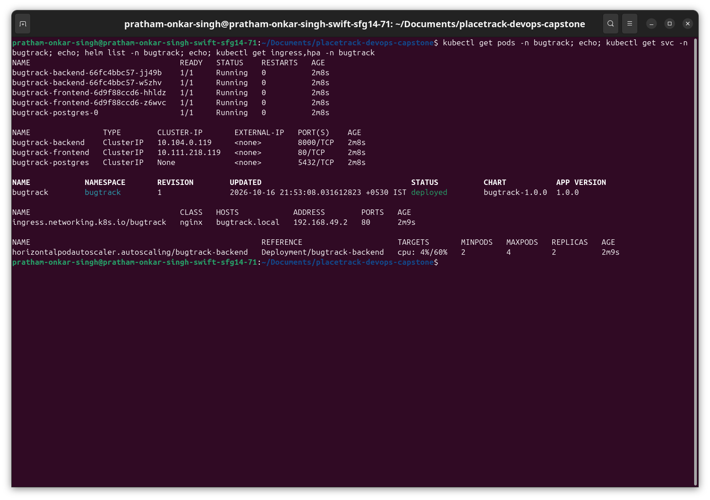

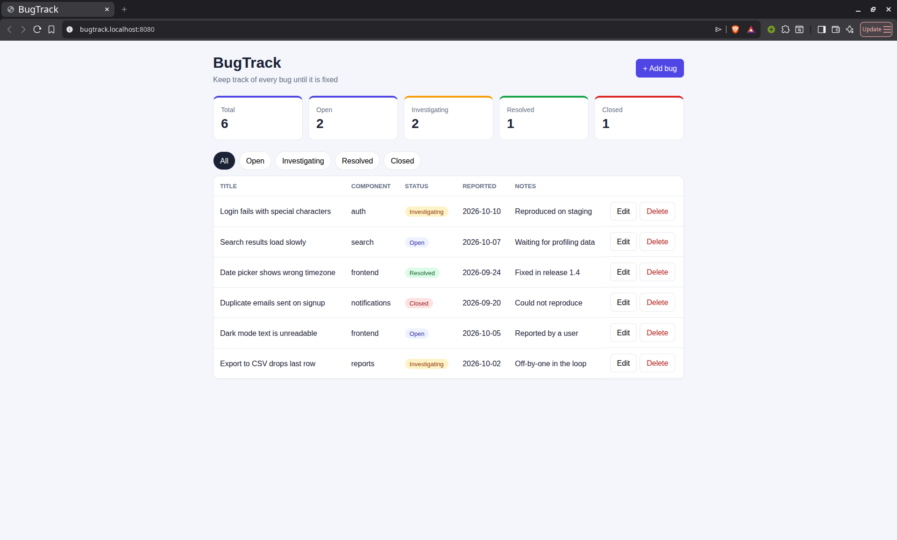

When I ran the load test, CPU went above the 60% target and the HPA added a third backend pod:

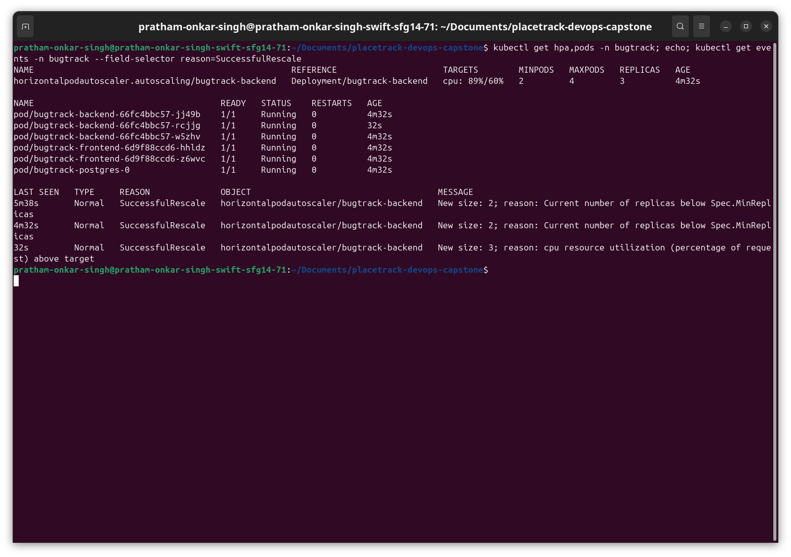

### GitOps with ArgoCD

ArgoCD keeps the cluster in sync with this repo. `argocd/application.yaml` points it at `helm/bugtrack` on `main`, and `argocd/values.yaml` holds the image tag it should run. To release a version I put the commit SHA the pipeline pushed into that file, commit and push, and ArgoCD rolls it out by itself (automated sync with prune and self-heal).

```bash
kubectl apply -f argocd/application.yaml
kubectl -n argocd get application bugtrack        # SYNC STATUS: Synced, HEALTH STATUS: Healthy
```

The chart creates the database password with `lookup`, which ArgoCD cannot use. The Application ignores differences on that one Secret, so the password made on the first sync is kept.

## M9: Monitoring

The backend exposes `/metrics`. `monitoring/install.sh` installs Prometheus and Grafana (kube-prometheus-stack), and the ServiceMonitor in my chart tells Prometheus to scrape the backend pods. I made a small Grafana dashboard (`monitoring/grafana-dashboard.json`) with requests per second, p95 latency, errors, and the number of backend pods.

```bash
./monitoring/install.sh
helm upgrade bugtrack helm/bugtrack -n bugtrack --reuse-values --set serviceMonitor.enabled=true
./scripts/load-test.sh http://localhost:8080 60
```

The load test only asks for bugs that exist, so the error panel stays at zero. This is what Prometheus exposes from the backend:

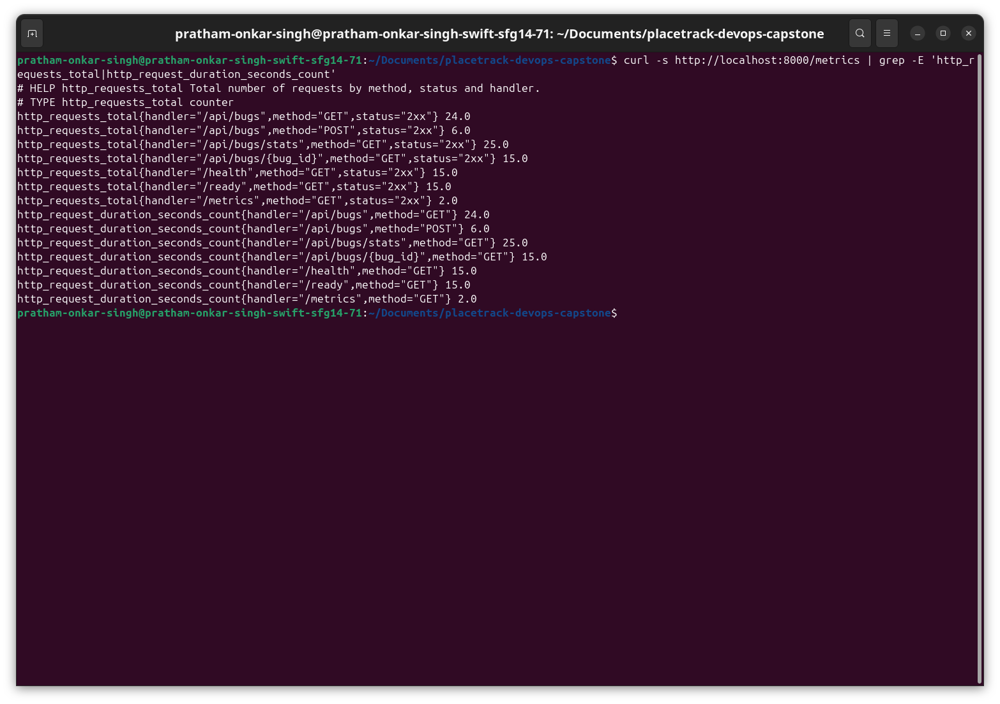

Prometheus scrapes all backend pods and they are all `UP`:

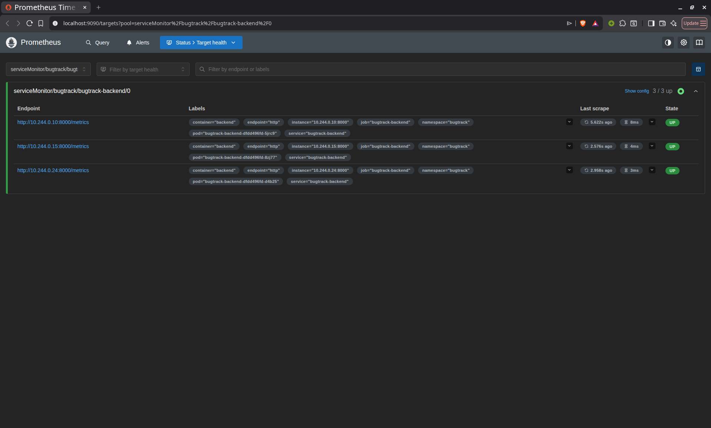

To open Grafana and Prometheus from my laptop I used port-forwards. `install.sh` creates the Grafana admin password and stores it in a Secret, so it is never in the repo:

```bash
kubectl -n monitoring get secret grafana-admin -o jsonpath='{.data.admin-password}' | base64 -d   # user: admin
kubectl -n monitoring port-forward svc/monitoring-grafana 3001:80                                  # http://localhost:3001
kubectl -n monitoring port-forward svc/monitoring-kube-prometheus-prometheus 9090:9090            # http://localhost:9090
```

The dashboard shows 3 pods because the HPA had just scaled up. For this screenshot I installed Grafana with anonymous viewing switched on (`--set grafana."grafana\.ini".auth.anonymous.enabled=true`, role Viewer), so the page opens without a login. With the plain `install.sh` you log in as `admin` with the password above.

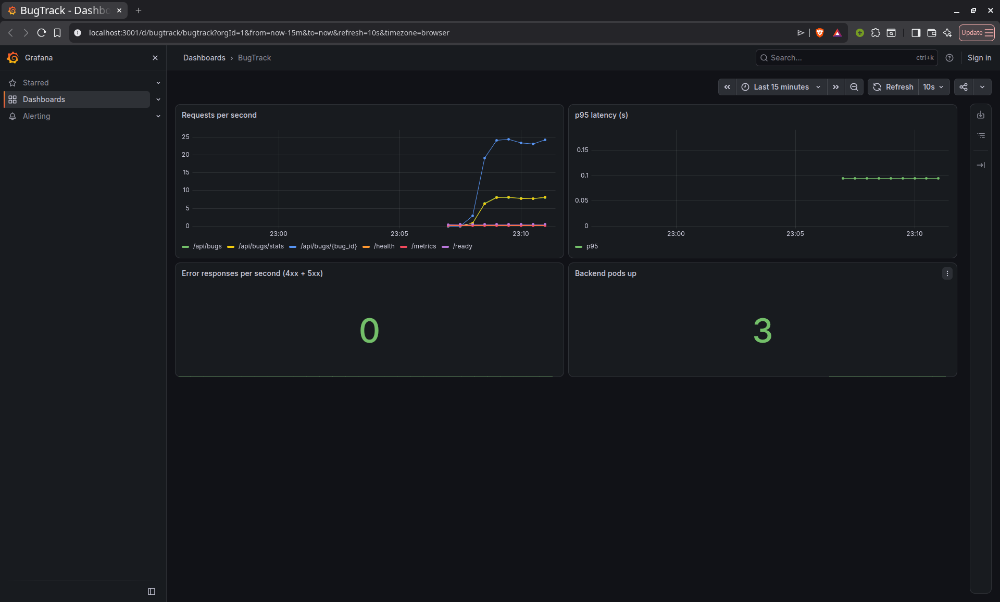

## Troubleshooting

I broke two things on purpose to practise finding problems: a wrong image tag (`ImagePullBackOff`) and a Service with a wrong selector (no endpoints). How I found and fixed each one is in [troubleshooting/](troubleshooting/README.md).

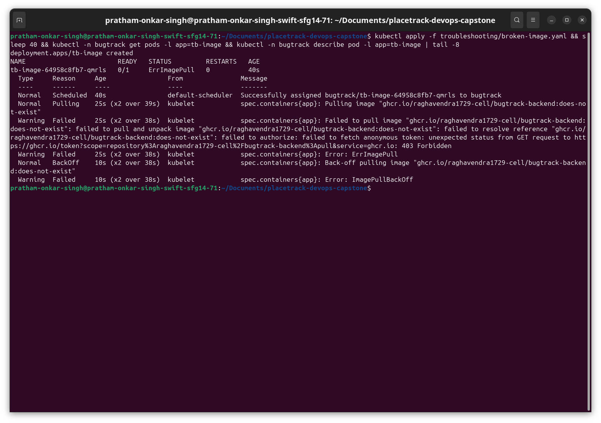

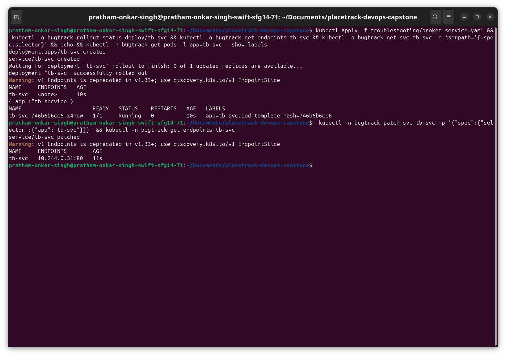

## Live demo

1. Open the app at `http://bugtrack.local:8080`.
2. Change the subtitle in `frontend/src/App.jsx`, then `git commit` and `git push`.
3. Watch the pipeline in GitHub Actions: test, frontend, image and then deploy.
4. The deploy job runs `scripts/deploy.sh` with the commit SHA. Watch the pods change with `kubectl -n bugtrack get pods -w`.
5. Refresh the browser and the new subtitle is there.

## What I learned

* A build that passes can still be insecure. Trivy is there to catch what the tests cannot.
* nginx looks up the backend name only once when it starts, and its resolver does not use the Kubernetes search domains. The frontend uses `NGINX_ENTRYPOINT_LOCAL_RESOLVERS` and the full name `<service>.<namespace>.svc.cluster.local` to avoid a 502.
* A pod can be Running but not Ready. The backend pods stay at 0/1 until they can reach Postgres, because `/ready` checks the database.
* The database password Secret has to survive `helm uninstall`, because the Postgres volume still has the old password.
* Passwords are generated at deploy time and never committed.
